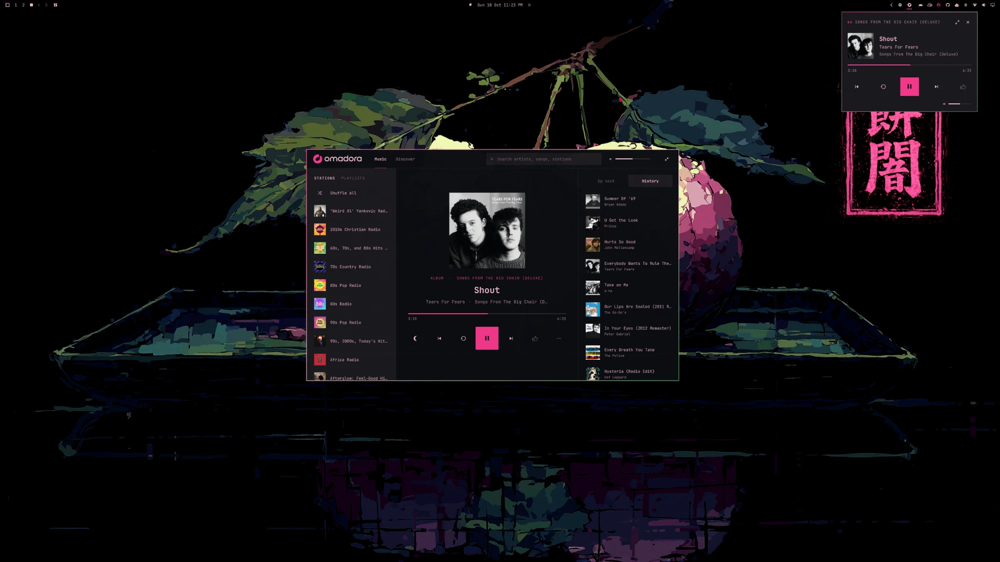

# Omadora

Pandora in the Omarchy bar.

> Omadora is an unofficial, personal project. It is not affiliated with,
> endorsed by, or supported by Pandora Media or SiriusXM. It talks to
> Pandora's unofficial APIs, which can change or stop working at any time,
> and it needs your own Pandora account. Pandora is a trademark of Pandora
> Media, LLC; the Omadora lettering is a nod to its wordmark.



<p>
  
  
</p>

<p align="center"></p>

The bar shows the Omadora mark. Left-click it for the mini player (art, progress, transport). The expand control opens the full player as a regular window that Hyprland tiles like any other app: stations and playlists on the left, the track in the middle, up next and history on the right. The shrink control returns to the mini player. Colors come from the active Omarchy theme.

`omadora-engine` (in `engine/`) plays everything: your radio stations, Shuffle, and albums, playlists, and songs on demand. It also serves the catalog: search, artist pages, albums, and playlists. On demand, the controls are previous, replay, play, and next. On radio they are thumbs, replay, play, skip, tired, and the station's modes, within what Pandora allows for each song. Drag the progress bar to scrub wherever replays are allowed. Volume is the system output.

Pandora lets one device play an account at a time. When another one is playing, the player says so and offers Listen here, which takes the account over the way Pandora's own "Let me listen" does.

Typing in search filters your stations; Enter searches Pandora for songs, artists, albums, and playlists. Artist pages have the bio, popular songs, the discography, and similar artists. Album and playlist pages list every track; picking one plays from there. Clicking the artist, the album, or the album or playlist name under the track opens its page, and Back retraces the way you came. Songs and albums your Pandora plan cannot play on demand say so, and start a station instead. Clicking a song in Up next jumps to it.

The mode chips are the current station's own modes (My Station, Crowd Faves, Deep Cuts, and whatever else Pandora offers for it); a new mode starts with the next song. The moon sets a sleep timer (15, 30, 60 minutes, off) that pauses whatever is playing, and the overflow menu marks a radio song as tired.

The widget starts the engine on its own and restarts it if it dies; the engine keeps its Pandora session across restarts, so it stays the one device listening. Left-click opens and closes the player. Middle-click and the wheel skip forward.

It also remembers where you were. After a restart or a reboot the player comes back paused on the same song at the same spot: the album or playlist with its Up next, or the station with the song that was on. Play picks up from there. Nothing plays or reaches Pandora until you press play, so a restart never takes your account from another device. On radio, the station's next songs are fetched once you do, and if the saved song is too old to play, the station starts fresh instead. Where you were lives in `~/.local/state/omadora/resume.json`.

## Discover

Discover, next to Music in the header, is a magazine of the latest reviews and news from music magazines' RSS feeds. Articles with a picture are cards, filtered by feed; stories without one are listed in the Headlines column on the right, which stays put whatever the filter. Each has chips for the album, song, or artist it is about on Pandora. A chip opens that page under Music; the headline opens the article itself in your browser. A strip along the bottom keeps what's playing in reach.

A chip appears only when Pandora's title and artist both agree with the article, so a review never links to the wrong record; articles about something Pandora doesn't have still show, without chips. Matches are looked up once and cached; an article that found nothing is tried again the next time the engine starts, in case Pandora has added it.

Discover starts with Pitchfork's reviews (Best New Albums, Best New Tracks, Album Reviews, and Track Reviews), Rolling Stone's music news, and Music Connection. Pitchfork's reviews link to the album or song; Rolling Stone's and Music Connection's stories, which have no pictures in their feeds, are headlines that link to the artists they cover.

Feeds are fetched at most every half hour, and a magazine whose server supports it (Rolling Stone's and Music Connection's do) answers an unchanged feed with an empty "not modified" instead of the whole feed. Cover pictures are downloaded once, when a card first comes into view, and kept in `~/.cache/omadora/images`; a picture not shown for a month is deleted. Add or replace feeds in `~/.config/omadora/feeds.toml`:

```toml
[[feed]]
name = "Pitchfork: Best New Albums"
url = "https://pitchfork.com/feed/reviews/best/albums/rss"
match = "pitchfork"

[[feed]]
name = "The Quietus: Reviews"
url = "https://thequietus.com/feed/"
match = "title"
```

`match` says how to tell what an article is about: `pitchfork` (Pitchfork's review titles and links), `title` (titles like "Artist – Album" or "Artist, “Album”"), `tags` (the article's categories name artists; section tags like "Music News" are skipped, and artists in the headline come first), `headline` (the headline starts with the artist's name, as in "Orbital Revisits…"; a column's name before a colon is skipped, and the article must mention the artist too), or `none` (show it, match nothing). A tag can name someone outside music who shares a name with an artist; that article then links to the artist. When the file has feeds, they replace the defaults, so list Pitchfork's too if you want to keep them. Most magazines publish standard RSS (many from WordPress), so a new one usually needs only the right `match`; one with its own style needs a small matcher in `engine/src/discover.rs`.

## Install

```bash
omarchy plugin add https://github.com/scttymn/omadora.git --enable
```

On first start, the widget downloads the Omadora engine for this version from the project's [GitHub releases](https://github.com/scttymn/omadora/releases) into the plugin's `bin/`, and uses it only if it matches the SHA-256 recorded in `engine-release.json`. `omarchy plugin update scttymn.omadora` brings a new version; the widget then fetches its engine and restarts it. Radio needs ffmpeg, which is part of Omarchy. Engines are released for x86_64 and aarch64.

To remove it: `omarchy plugin remove scttymn.omadora`. Signing out first also clears the saved account from the keyring.

## Sign in

Open the player and sign in with your Pandora email and password. The engine checks them with Pandora, then keeps the password in your system keyring (via `secret-tool`) and the email in `~/.config/omadora/account`; the password is never written to a file. Sign out from the account button in the full player's header, which forgets both and stops playback.

Any Pandora account works: free accounts get radio, and Plus and Premium add what Pandora gives them (replays, skips, albums and playlists on demand).

The engine listens on `$XDG_RUNTIME_DIR/omadora/engine.sock` and keeps its session beside it; [engine/README.md](engine/README.md) has its protocol and how it signs in.

## Development

The engine needs a Rust toolchain. From a checkout:

```bash
make install
omarchy-shell shell rescanPlugins
omarchy plugin enable scttymn.omadora right
```

`make install` builds the engine into `bin/`, copies the plugin to `~/.config/omarchy/plugins/scttymn.omadora` (Omarchy will not load a symlinked plugin), and stops a running engine so the widget starts the new one. A build from `make` is never replaced by a download. Saving a file under that plugin directory reloads it, though a changed QML type sometimes needs `omarchy-restart-shell`.

To release: bump the version in `manifest.json` and `engine/Cargo.toml`, tag `vX.Y.Z` and push the tag. The release workflow builds the engines and attaches them to a GitHub release; then `make pin VERSION=X.Y.Z` records their checksums in `engine-release.json`, and committing that lets installs download it.
