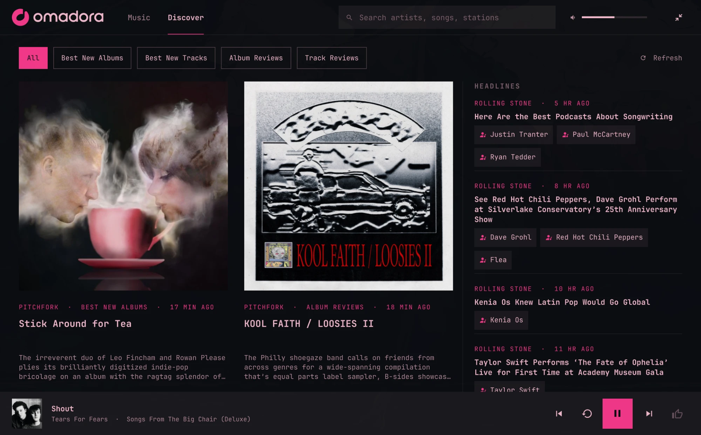
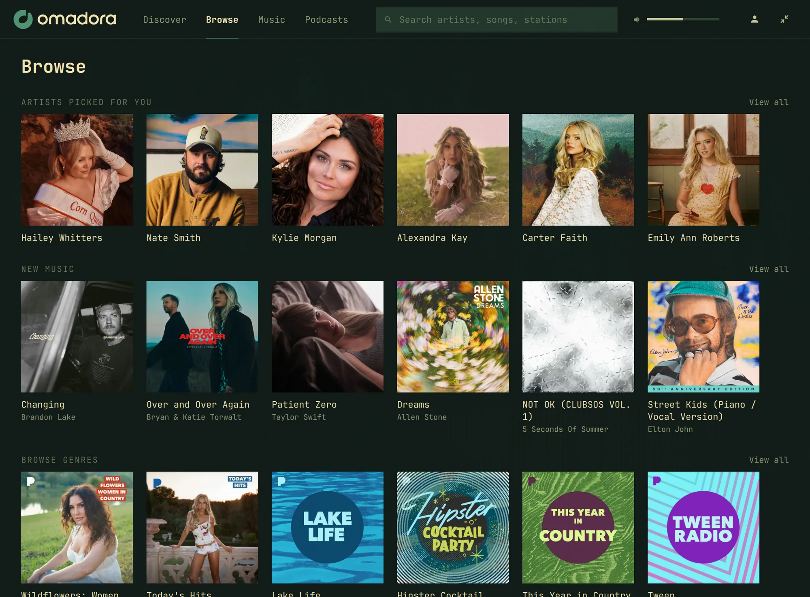
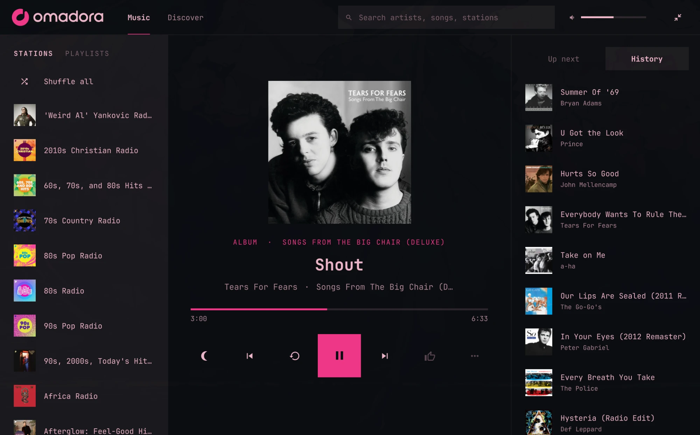
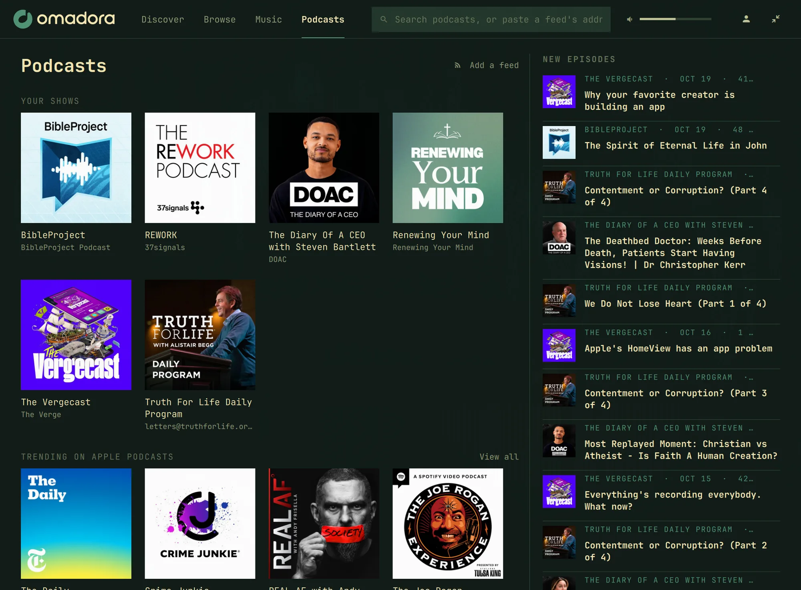

# Omadora

Pandora in the Omarchy bar.

> Omadora is an unofficial, personal project. It is not affiliated with,
> endorsed by, or supported by Pandora Media or SiriusXM. It talks to
> Pandora's unofficial APIs, which can change or stop working at any time,
> and it needs your own Pandora account. Pandora is a trademark of Pandora
> Media, LLC; the Omadora lettering is a nod to its wordmark.



<p>
  
  
  
</p>

<p align="center"></p>

The bar shows the Omadora mark. Left-click it for the mini player (art, progress, transport), or, with nothing playing, the full player. The expand control opens the full player as a regular window that Hyprland tiles like any other app. Its header has four places: Discover (where it opens), Browse, Music (your stations, playlists, and artists), and Podcasts. Each keeps its own pages, so going back to one finds you where you left it; choosing the one you're in takes you back to its start. What's playing is in a strip along the bottom; click it for the track itself, with up next, history, and AI beside it. The collapse control closes it. Colors come from the active Omarchy theme.

Pages open at once with what they showed last time, then update as fresh answers arrive, so a restart doesn't mean waiting on the network; artwork is kept on disk too, in `~/.cache/omadora/images`.

Music shows a row or two of each kind, with filters for all of one: Shuffle all and your stations (hover one to remove it from your account; it asks first), your playlists, and your artists. The artists are those of the albums and songs in your collection and of the songs you've thumbed up on stations (Pandora keeps those in your My Thumbs Up playlist), the way Pandora's own My Collection does (Pandora's collection holds no artists itself); pick one to open their page, which starts with what of theirs is in your collection. Hover an album or song there to take it out (it asks first): out of your collection, and any station thumbs up on it removed.

Browse is Pandora's own: new music, artists on the rise, top artists, moods and activities, and top stations, each with View all. Albums and artists open their pages, a mood lists its stations, and a station starts playing (your own, if you have one by that name).

`omadora-engine` (in `engine/`) plays everything: your radio stations, Shuffle, and albums, playlists, and songs on demand. It also serves the catalog: search, artist pages, albums, and playlists. On demand, the controls are previous, replay, play, next, and thumbs up, which adds the song to your collection (solid when it's there; press again to take it out). On radio they are thumbs, replay, play, skip, tired, and the station's modes, within what Pandora allows for each song; a thumb there is feedback to the station. Drag the progress bar to scrub wherever replays are allowed. Volume is the system output.

Pandora lets one device play an account at a time. When another one is playing, the player says so and offers Listen here, which takes the account over the way Pandora's own "Let me listen" does.

Search finds songs, artists, albums, and playlists, with your own stations that match first (under Podcasts, it finds shows). Artist pages have the bio, popular songs, the discography, and similar artists. Album and playlist pages list every track; picking one plays from there. Clicking the artist, the album, or the album or playlist name under the track opens its page, and Back retraces the way you came. Songs and albums your Pandora plan cannot play on demand say so, and start a station instead. Clicking a song in Up next jumps to it.

The mode chips are the current station's own modes (My Station, Crowd Faves, Deep Cuts, and whatever else Pandora offers for it); a new mode starts with the next song. The moon sets a sleep timer (15, 30, 60 minutes, off) that pauses whatever is playing, and the overflow menu marks a radio song as tired.

The widget starts the engine on its own and restarts it if it dies; the engine keeps its Pandora session across restarts, so it stays the one device listening. Left-click opens and closes the player. Middle-click and the wheel skip forward.

It also remembers where you were. After a restart or a reboot the player comes back paused on the same song at the same spot: the album or playlist with its Up next, or the station with the song that was on. Play picks up from there. Nothing plays or reaches Pandora until you press play, so a restart never takes your account from another device. On radio, the station's next songs are fetched once you do, and if the saved song is too old to play, the station starts fresh instead. It survives signing out, too: signing back in with the same account picks up where you were, while a different account starts fresh. Where you were lives in your account's folder, `~/.local/share/omadora/accounts/ID` (ID being a hash of the account, so the folder doesn't spell out the email), with its podcasts and the pages saved for it.

## Discover

Discover, the first place in the header, is a magazine of the latest reviews and news from music magazines' RSS feeds. Articles with a picture are cards, filtered by feed; stories without one are listed in the Headlines column on the right, which stays put whatever the filter. Each has chips for the album, song, or artist it is about on Pandora. A chip opens that page within Discover; the headline opens the article itself in your browser, once the engine has followed the link and found it, and every redirect on the way, on the public web (the browser then fetches it itself, as from any feed reader). A strip along the bottom keeps what's playing in reach.

A chip appears only when Pandora's title and artist both agree with the article, so a review never links to the wrong record; articles about something Pandora doesn't have still show, without chips. Matches are looked up once and cached; an article that found nothing is tried again the next time the engine starts, in case Pandora has added it.

Discover starts with Pitchfork's reviews (Best New Albums, Best New Tracks, Album Reviews, and Track Reviews), Rolling Stone's music news, and Music Connection. Pitchfork's reviews link to the album or song; Rolling Stone's and Music Connection's stories, which have no pictures in their feeds, are headlines that link to the artists they cover.

Feeds are fetched at most every half hour, and a magazine whose server supports it (Rolling Stone's and Music Connection's do) answers an unchanged feed with an empty "not modified" instead of the whole feed. Cover pictures are downloaded once, when a card first comes into view, and kept in `~/.cache/omadora/images`; a picture not shown for a month is deleted. Add or replace feeds in `~/.config/omadora/feeds.toml`:

```toml
[[feed]]
name = "Pitchfork: Best New Albums"
url = "https://pitchfork.com/feed/reviews/best/albums/rss"
match = "pitchfork"

[[feed]]
name = "The Quietus: Reviews"
url = "https://thequietus.com/feed/"
match = "title"
```

`match` says how to tell what an article is about: `pitchfork` (Pitchfork's review titles and links), `title` (titles like "Artist – Album" or "Artist, “Album”"), `tags` (the article's categories name artists; section tags like "Music News" are skipped, and artists in the headline come first), `headline` (the headline starts with the artist's name, as in "Orbital Revisits…"; a column's name before a colon is skipped, and the article must mention the artist too), or `none` (show it, match nothing). A tag can name someone outside music who shares a name with an artist; that article then links to the artist. When the file has feeds, they replace the defaults, so list Pitchfork's too if you want to keep them. Most magazines publish standard RSS (many from WordPress), so a new one usually needs only the right `match`; one with its own style needs a small matcher in `engine/src/discover.rs`.

## Podcasts

Podcasts come from three places at once, none needing an account beyond Pandora's: Pandora's own shows, Apple's public podcast directory (which leads to each show's RSS feed, for shows Pandora lacks), and any feed you add by its address ("Add a feed", or paste it into search). When a show turns up in more than one, it's listed once, from whichever has the newest episode, so a show that moved hosts doesn't come back stale.

Your shows are the podcasts you follow on Pandora plus the feeds you follow here. Following a show Pandora has (even one found through Apple) follows it on Pandora too, so Pandora's apps list it; unfollowing takes it out of both. The tab lists your shows, their newest episodes, and what's trending on Apple Podcasts; a show's page has its episodes, each with how much is left or that it's played (hover one to mark it either way).

Episodes stream as they download, so a long one starts in seconds, and each picks up where you left it. Up next is your new episodes you haven't played, in the order the tab lists them; history is what you've listened to lately; and the AI tab suggests other podcasts like the one playing (only the show's name and the episode's title go to the agent), each checked against Pandora and Apple so every one opens. Anyone who publishes a feed writes its titles, so they go to the agent as one short line each. The controls go back 15 seconds and ahead 30. Downloaded episodes are kept in `~/.cache/omadora/episodes`, up to 2 GB, oldest first out.

## AI

The AI tab, next to Up next and History, suggests songs and artists like the one playing. It asks an AI agent only while the tab is on screen, a few seconds after the song changes (so skipping through songs doesn't ask about each one), and keeps each song's answer. Every suggestion is checked against the catalog, preferring original recordings over remixes, so everything listed plays: click a song to play it (or start a station from it, when your plan can't play songs on demand), or an artist to open their page. Only the song playing (its title, artist, and album) goes to the agent and its provider; nothing about your listening history does.

It uses Omarchy's default agent (`omarchy default agent`) and never changes it; with none set, the tab asks you to set one. Claude Code, Codex, Cursor, Antigravity, Gemini, Muse Code, OpenCode, GitHub Copilot, Crush, Grok, Pi, and Oh My Pi work (Omarchy's `gemini` is treated as Antigravity when that's what the command now runs). Each runs headless from a private, empty folder, with the song sent on standard input (Muse Code reads it from a private file); it's never on a command line. Tools are turned off for Claude Code, Copilot, Pi, and Oh My Pi; Cursor runs in its read-only ask mode and Codex in its read-only sandbox; the others have no switch for that. The tab's header names the agent, model, and effort: "From Codex · GPT-6-Astra · high", with a button to ask again. Model and effort are menus of what that agent offers, read from the agent itself so they stay current (Codex's model cache, with each model's efforts; Claude Code's own help; `agy models`; `grok models`; Cursor's `--list-models`; `opencode models`), and the choice is saved for Omadora alone. Agents that can't list their models show just their name.

Everything is also in `~/.config/omadora/settings.toml`:

```toml
[ai]
# What to suggest; Omadora adds what's playing and the answer's format.
prompt = "Suggest 8 deep cuts from the same scene and decade, no hits."
# An agent other than Omarchy's default, for Omadora only
# (for example "antigravity", which Omarchy doesn't offer yet).
# agent = "claude"
# Or any command instead of an agent: the prompt on stdin, the answer on stdout.
# command = "my-llm --json"

[ai.codex]
# What the tab's menus save; unset, the agent uses its own setting.
model = "gpt-6-luna"
effort = "low"
```

## Install

```bash
omarchy plugin add https://github.com/scttymn/omadora.git --enable
```

On first start, the widget downloads the Omadora engine for this version from the project's [GitHub releases](https://github.com/scttymn/omadora/releases) into `~/.local/share/omadora/engine/`, and uses it only if it matches the SHA-256 recorded in `engine-release.json`. `omarchy plugin update scttymn.omadora` brings a new version; the widget then fetches its engine and restarts it. Radio needs ffmpeg, which is part of Omarchy. Engines are released for x86_64 and aarch64.

To remove it:

```bash
omarchy plugin remove scttymn.omadora
```

Removing the plugin runs none of its code, so your Pandora password stays in the desktop keyring (GNOME Keyring, which Omarchy runs). Sign out in the player first, or clear it afterwards with `secret-tool clear application omadora`. The engine also keeps running, signed in, until you log out; stop it with `pkill -x omadora-engine`. Omadora's other files are in `~/.config/omadora`, `~/.local/state/omadora`, `~/.local/share/omadora` (the downloaded engine, and each account's folder), and `~/.cache/omadora` (pictures and episodes).

## Sign in

Open the player and sign in with your Pandora email and password. The engine checks them with Pandora, then keeps the password in your system keyring (via `secret-tool`) and the email in `~/.config/omadora/account`; the password is never written to a file. Sign out from the account button in the full player's header, which forgets both and stops playback.

Every Pandora plan works. Free plays radio with Pandora's audio ads, an ad every few songs, which can't be skipped and are reported to Pandora as its own apps do. Plus plays radio without ads, and Premium adds albums, playlists, and songs on demand. Without on demand, songs show as radio only and start their station.

The engine listens on `$XDG_RUNTIME_DIR/omadora/engine.sock` and keeps its session beside it; [engine/README.md](engine/README.md) has its protocol and how it signs in.

## Development

The engine needs a Rust toolchain. From a checkout:

```bash
make install
omarchy-shell shell rescanPlugins
omarchy plugin enable scttymn.omadora right
```

`make install` builds the engine into `bin/`, copies the plugin (without `.git`) to `~/.config/omarchy/plugins/scttymn.omadora` (Omarchy will not load a symlinked plugin), and stops a running engine so the widget starts the new one. Outside a git clone, the widget prefers that build to a downloaded release; in a clone from GitHub, `bin/` is never used, so only a download the pin vouches for runs. To go back to updates from GitHub, reinstall with `omarchy plugin add`. Saving a file under that plugin directory reloads it, though a changed QML type sometimes needs `omarchy-restart-shell`.

To release: bump the version in `manifest.json` and `engine/Cargo.toml`, tag `vX.Y.Z` and push the tag. The release workflow builds the engines and attaches them to a GitHub release; then `make pin VERSION=X.Y.Z` downloads both binaries, checks them against the release's checksums, and records their SHA-256 in `engine-release.json`. Committing that lets installs download it. Pin right after the workflow finishes, and from your own machine.
